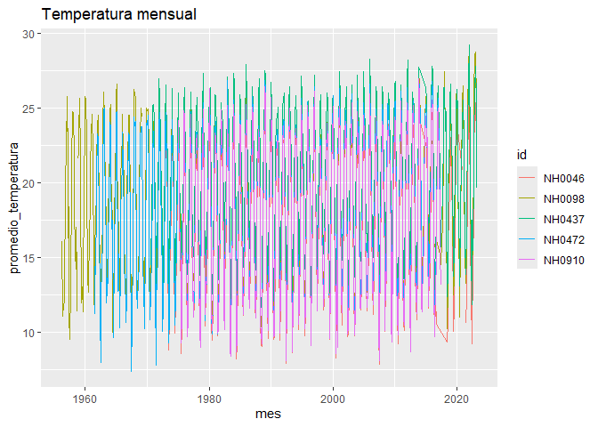

<!-- README.md is generated from README.Rmd. Please edit that file -->

# quecaloR

<!-- badges: start -->

[](https://lifecycle.r-lib.org/articles/stages.html#experimental)
[](https://github.com/Nana-0001/quecaloR/actions/workflows/R-CMD-check.yaml)
[](https://app.codecov.io/gh/Nana-0001/quecaloR)
<!-- badges: end -->

¡Te damos la bienvenida! quecaloR es un paquete de R creado por Ana
Gomez y Sofia Brunelli como trabajo del curso Introducción a la
Programación II.

quecaloR ayuda a explorar datos diarios de estaciones meteorológicas del
Instituto Nacional de Tecnología Agropecuaria (INTA), disponibles a
través del Sistema de Información y Gestión Agropecuaria (SIGA). Incluye
datos de cinco estaciones y funciones para resumir la temperatura,
graficarla mes a mes y descargar los datos de cada estación.

**¿A quién va dirigido?** A cualquier persona que quiera empezar a
trabajar con datos meteorológicos en R, sin experiencia previa con este
tipo de datos.

**¿Por qué existe?** Para reunir en un solo lugar los datos y unas pocas
funciones que simplifican los primeros pasos de un análisis.

## Instalación

Podés instalar la versión en desarrollo desde GitHub con:

``` r
# install.packages("pak")
pak::pak("Nana-0001/quecaloR")
```

## Ejemplos

El paquete incluye el set de datos `datos_estaciones`, con datos diarios
de cinco estaciones:

``` r
library(quecaloR)

head(datos_estaciones[, c("id", "fecha", "temperatura_abrigo_150cm")])
#>       id      fecha temperatura_abrigo_150cm
#> 1 NH0472 1961-07-01                     11.1
#> 2 NH0472 1961-07-02                      5.5
#> 3 NH0472 1961-07-03                      6.0
#> 4 NH0472 1961-07-04                       NA
#> 5 NH0472 1961-07-05                     12.4
#> 6 NH0472 1961-07-06                     11.0
```

Con `tabla_resumen_temperatura()` se obtiene el promedio y el desvío
estándar de la temperatura de cada estación:

``` r
tabla_resumen_temperatura(datos_estaciones)
#> # A tibble: 10 × 3
#>    id     estadistico     valor
#>    <chr>  <chr>           <dbl>
#>  1 NH0046 promedio        17.3 
#>  2 NH0046 desvio_estandar  5.90
#>  3 NH0098 promedio        18.6 
#>  4 NH0098 desvio_estandar  5.98
#>  5 NH0437 promedio        20.2 
#>  6 NH0437 desvio_estandar  5.77
#>  7 NH0472 promedio        18.0 
#>  8 NH0472 desvio_estandar  5.94
#>  9 NH0910 promedio        17.7 
#> 10 NH0910 desvio_estandar  6.12
```

Con `grafico_temperatura_mensual()` se grafica el promedio mensual de la
temperatura:

``` r
grafico_temperatura_mensual(datos_estaciones, titulo = "Temperatura mensual")
#> Warning: Removed 1 row containing missing values or values outside the scale range
#> (`geom_line()`).
```



Con `leer_estacion()` se descarga y lee una estación del repositorio del
curso:

``` r
nh0437 <- leer_estacion("NH0437", "data-raw/NH0437.csv")
```

Para más detalles, mirá la viñeta del paquete y la documentación de cada
función (por ejemplo `?tabla_resumen_temperatura`).

## Autoras

- Ana Gomez (autora y mantenedora)
- Sofia Brunelli (autora)

## Cómo contribuir

Toda ayuda es bienvenida: avisarnos de errores, sugerir mejoras, mejorar
la documentación o proponer nuevas funciones. Para contribuir podés leer
la [guía de contribución](.github/CONTRIBUTING.md). Al participar en
este proyecto aceptás respetar el [código de
conducta](CODE_OF_CONDUCT.md). Si encontrás un error o tenés una idea,
abrí un [issue](https://github.com/Nana-0001/quecaloR/issues) en GitHub.
