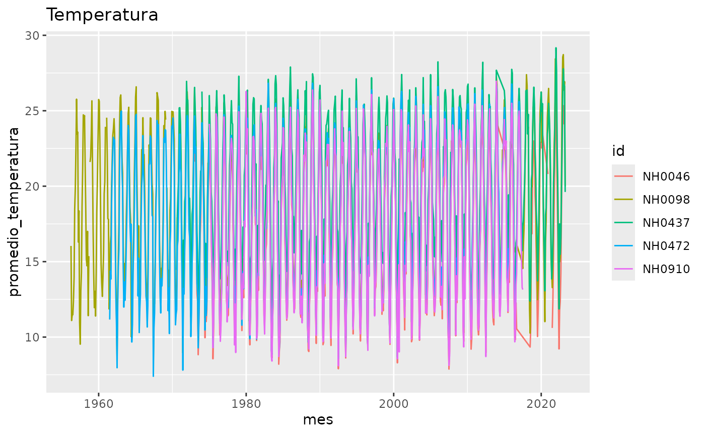
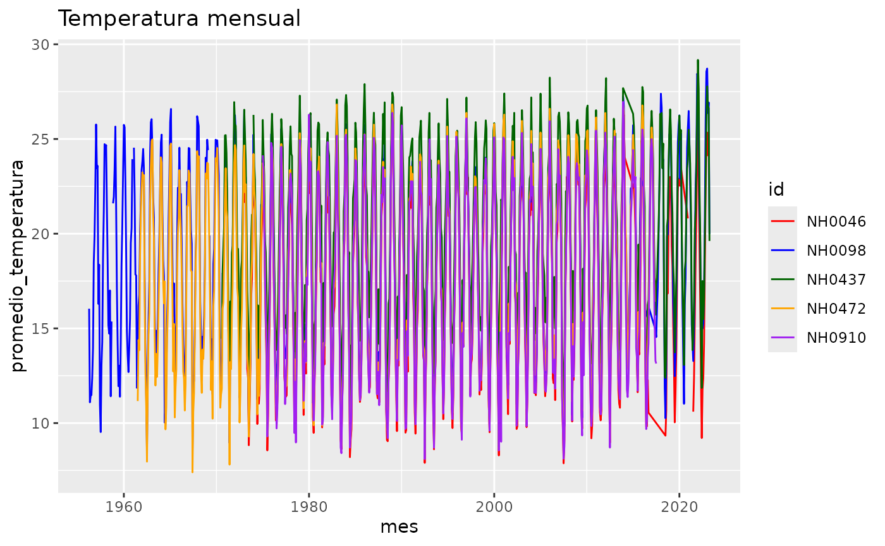
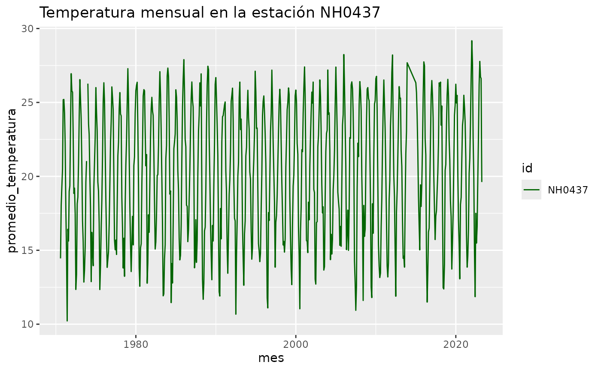

# Introducción a quecaloR

``` r

library(quecaloR)
```

quecaloR ofrece herramientas para trabajar con datos diarios de
estaciones meteorológicas del INTA (SIGA). Esta viñeta muestra cómo usar
sus funciones y el set de datos que incluye.

## Los datos

El paquete trae el set de datos `datos_estaciones`, con datos diarios de
cinco estaciones identificadas por la columna `id`.

``` r

dim(datos_estaciones)
#> [1] 95681    35
unique(datos_estaciones$id)
#> [1] "NH0472" "NH0910" "NH0046" "NH0098" "NH0437"
```

Algunas de las columnas más usadas son la fecha, la temperatura de
abrigo a 150 cm y la precipitación:

``` r

head(datos_estaciones[, c("id", "fecha", "temperatura_abrigo_150cm",
                          "precipitacion_pluviometrica")])
#>       id      fecha temperatura_abrigo_150cm precipitacion_pluviometrica
#> 1 NH0472 1961-07-01                     11.1                           0
#> 2 NH0472 1961-07-02                      5.5                           0
#> 3 NH0472 1961-07-03                      6.0                           0
#> 4 NH0472 1961-07-04                       NA                           0
#> 5 NH0472 1961-07-05                     12.4                           0
#> 6 NH0472 1961-07-06                     11.0                           0
```

Para ver el detalle de todas las variables, consultá
[`?datos_estaciones`](https://nana-0001.github.io/quecaloR/reference/datos_estaciones.md).

## Resumir la temperatura

[`tabla_resumen_temperatura()`](https://nana-0001.github.io/quecaloR/reference/tabla_resumen_temperatura.md)
calcula el promedio y el desvío estándar de la temperatura de abrigo a
150 cm de cada estación.

``` r

tabla_resumen_temperatura(datos_estaciones)
#> # A tibble: 10 × 3
#>    id     estadistico     valor
#>    <chr>  <chr>           <dbl>
#>  1 NH0046 promedio        17.3 
#>  2 NH0046 desvio_estandar  5.90
#>  3 NH0098 promedio        18.6 
#>  4 NH0098 desvio_estandar  5.98
#>  5 NH0437 promedio        20.2 
#>  6 NH0437 desvio_estandar  5.77
#>  7 NH0472 promedio        18.0 
#>  8 NH0472 desvio_estandar  5.94
#>  9 NH0910 promedio        17.7 
#> 10 NH0910 desvio_estandar  6.12
```

El resultado está en formato largo: cada fila es una estación y un
estadístico (`promedio` o `desvio_estandar`), con su valor en la columna
`valor`.

La función también sirve con una sola estación. Para eso basta con
quedarse con las filas de la estación que interesa:

``` r

nh0437 <- datos_estaciones[datos_estaciones$id == "NH0437", ]
tabla_resumen_temperatura(nh0437)
#> # A tibble: 2 × 3
#>   id     estadistico     valor
#>   <chr>  <chr>           <dbl>
#> 1 NH0437 promedio        20.2 
#> 2 NH0437 desvio_estandar  5.77
```

## Graficar la temperatura mensual

[`grafico_temperatura_mensual()`](https://nana-0001.github.io/quecaloR/reference/grafico_temperatura_mensual.md)
grafica el promedio mensual de la temperatura de abrigo a 150 cm, con
una línea por estación.

``` r

grafico_temperatura_mensual(datos_estaciones)
```



Con el argumento `titulo` se cambia el título, y con `colores` se elige
un color para cada estación. Si se usa `colores`, tiene que haber uno
por estación.

``` r

grafico_temperatura_mensual(
  datos_estaciones,
  colores = c("red", "blue", "darkgreen", "orange", "purple"),
  titulo = "Temperatura mensual"
)
```



También se puede graficar una sola estación:

``` r

grafico_temperatura_mensual(
  nh0437,
  colores = "darkgreen",
  titulo = "Temperatura mensual en la estación NH0437"
)
```



## Leer los datos de una estación

[`leer_estacion()`](https://nana-0001.github.io/quecaloR/reference/leer_estacion.md)
lee el archivo csv de una estación. Si el archivo no existe en la ruta
indicada, lo descarga antes de leerlo. Necesita conexión a internet la
primera vez.

``` r

ruta <- tempfile(fileext = ".csv")
estacion <- leer_estacion("NH0437", ruta)
```

La ruta puede ser cualquier lugar donde se quiera guardar el archivo,
por ejemplo `"data-raw/NH0437.csv"`.
